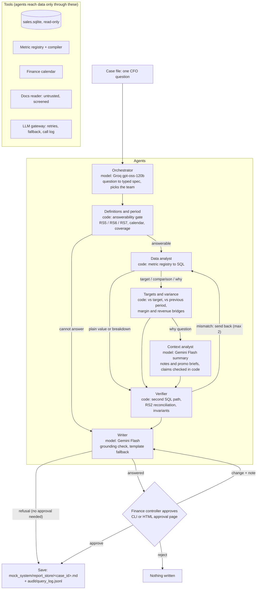

# Architecture

One orchestrator leads five specialists. The orchestrator's model understands the question;
code computes every number; a second calculation checks every number; a person approves
the answer before it is filed.

## How the team changes with the question

| Question | Agents that run |
| --- | --- |
| What was South's gross margin in August 2026? | Definitions, Data analyst, Verifier, Writer |
| Which sales channel had the highest net revenue in Q1 FY27? | Definitions, Data analyst, Verifier, Writer |
| Did Central meet its revenue target in July 2026? | + Targets and variance |
| Why did South's margin drop in September 2026? | + Targets and variance, Context analyst |
| Gross margin by salesperson / December 2026 / change a target | Definitions, Writer (stops at the gate) |

## State and persistence

Agents share a typed LangGraph state, not chat transcripts. It is checkpointed to
`.state/checkpoints.db` (SQLite) after every node, keyed by run id, so a run paused for
approval survives the process ending and resumes with `python -m app approve <run_id>`.

## Logs

| File | One line per |
| --- | --- |
| `logs/llm_calls.jsonl` | model call attempt: node, provider, model, status, latency, tokens, cost |
| `logs/trace.jsonl` | graph event: plan, gate decision, verifier result, approval |
| `mock_system/audit/query_log.jsonl` | SQL query of an approved run, rerunnable (RS3) |
